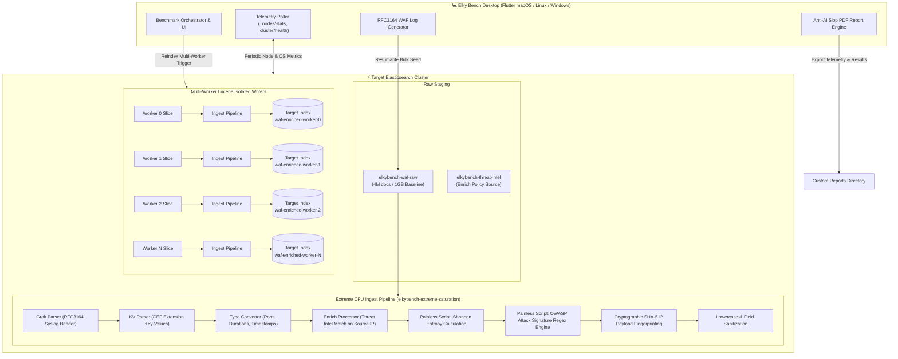

<p align="center">
  
</p>

<h1 align="center">Elky Bench</h1>

<p align="center">
  <strong>Enterprise-Grade Elasticsearch Saturation & Performance Benchmarking Desktop Suite</strong><br>
  <em>Engineered to push Elasticsearch clusters to 100% CPU saturation with realistic WAF log workloads, multi-worker Lucene-isolated indexing, and anti-slop technical PDF reports.</em>
</p>

<p align="center">
  <a href="#key-features"></a>
  <a href="#platforms"></a>
  <a href="#build-scripts"></a>
  <a href="#anti-ai-slop-technical-pdf-reports"></a>
</p>

---

## 📖 Table of Contents

- [Overview](#overview)
- [Why Elky Bench?](#why-elky-bench)
- [Architecture & Saturation Pipeline](#architecture--saturation-pipeline)
  - [1. Extreme CPU Saturation Ingest Pipeline](#1-extreme-cpu-saturation-ingest-pipeline)
  - [2. Multi-Worker Isolated Index Writer Architecture](#2-multi-worker-isolated-index-writer-architecture)
  - [3. Realistic WAF CEF Log Generator & High-Density Seeding](#3-realistic-waf-cef-log-generator--high-density-seeding)
  - [4. Complex Aggregation Search Benchmark](#4-complex-aggregation-search-benchmark)
  - [5. Live Telemetry & Real-Time Cluster Health](#5-live-telemetry--real-time-cluster-health)
  - [6. Anti-AI Slop Engineering PDF Reports](#6-anti-ai-slop-engineering-pdf-reports)
- [User Interface & Workflow](#user-interface--workflow)
- [Installation & Build Instructions](#installation--build-instructions)
  - [macOS (Apple Silicon & Intel)](#macos-apple-silicon--intel)
  - [Linux (x86_64 & ARM64)](#linux-x86_64--arm64)
  - [Windows (x64 & ARM64)](#windows-x64--arm64)
- [Configuration Reference](#configuration-reference)
- [Testing & Quality Assurance](#testing--quality-assurance)
- [Meet Elky 🦌](#meet-elky-)
- [License](#license)

---

## Overview

**Elky Bench** (`com.tebibyte.elky`) is a cross-platform desktop application built for DevOps engineers, Site Reliability Engineers (SREs), search architects, and database administrators who need **accurate, unconstrained, reproducible stress testing** for Elasticsearch.

Whether validating a managed Elastic Cloud deployment, tuning an on-premises self-hosted NVMe cluster, or sizing Kubernetes-based Elasticsearch nodes, Elky Bench generates realistic high-entropy security log workloads and saturates CPU cores and I/O pipelines without client-side bottlenecks.

---

## Why Elky Bench?

Most traditional Elasticsearch benchmarking tools suffer from several fundamental limitations:

| Traditional Benchmarking Tools | Elky Bench Approach |
| :--- | :--- |
| **Client-Side Bottlenecks**: Single-threaded bulk generators often bottleneck your laptop or client CPU before the Elasticsearch cluster breaks a sweat. | **Cluster-Offloaded Slicing**: Reindexing and ingest pipelines run natively inside Elasticsearch worker threads via slice partitioning, offloading heavy compute directly to the cluster nodes. |
| **Trivial Document Schemas**: Benchmarking on synthetic flat JSONs (e.g., `{ "id": 1, "msg": "test" }`) fails to exercise Lucene segment merges, Painless script engines, or Grok regex compilation. | **Real-World Security Payload Processing**: Evaluates RFC3164 Syslog + CEF WAF logs with dynamic payloads, base64 tokens, regex attack signatures (OWASP Top 10), and Shannon entropy calculations. |
| **Single Target Index Contention**: Directing massive bulk ingest into a single target index creates internal Lucene index writer write lock contention across shard threads. | **Multi-Worker Isolated Index Writers**: Each worker slice targets a dedicated isolated index (`elkybench-waf-enriched-worker-{i}`), distributing segment merges and disk I/O evenly across all primary shards. |
| **Vague AI-Generated Summaries**: Reports that provide generic paragraphs instead of actionable engineering metrics. | **Anti-AI Slop Engineering PDF Reports**: Exact hardware topology, node threadpool saturation, p50/p90/p95/p99 latency percentiles, and per-iteration delta logs. |

---

## Architecture & Saturation Pipeline



### 1. Extreme CPU Saturation Ingest Pipeline

The ingest pipeline (`elkybench-extreme-saturation`) is engineered to stress CPU instruction caches and memory bandwidth:
- **Grok Parser**: Extracts RFC3164 Syslog headers, timestamps, and host tags.
- **Key-Value (KV) Processor**: Splits CEF log attributes (`src=`, `dst=`, `cs1=`, `request=`, `msg=`).
- **Enrich Processor**: Matches client IP addresses against a Threat Intelligence lookup index (`elkybench-threat-intel`) to simulate production SIEM enrichment.
- **Painless Script - Shannon Entropy Calculation**: Computes the exact information entropy of incoming request payloads to detect base64 obfuscation and encrypted shells:
  $$\mathrm{Entropy} = -\sum_{i=1}^{n} P(c_i) \log_2 P(c_i)$$
- **Painless Script - Attack Signature Engine**: Runs heavy regex matching across multiple attack vectors:
  - *SQL Injection*: `' OR 1=1`, `UNION SELECT`, `SLEEP()`, `INFORMATION_SCHEMA`
  - *Cross-Site Scripting (XSS)*: `<script>`, `onload=`, `javascript:`, `document.cookie`
  - *Remote Code Execution (RCE)*: `; id;`, `| whoami`, `bash -i`, `/bin/sh`
  - *Path Traversal / LFI*: `../../etc/passwd`, `..\windows\system.ini`
  - *Server-Side Request Forgery (SSRF)*: `http://169.254.169.254/latest/meta-data/`
- **Fingerprint Processor**: Calculates a cryptographic **SHA-512** hash of the normalized payload.

### 2. Multi-Worker Isolated Index Writer Architecture

Instead of reindexing all slices into a single destination index (which causes Lucene lock contention on `IndexWriter.prepareCommit`), Elky Bench creates **isolated destination indices for each active worker**:
- `elkybench-waf-enriched-worker-0`
- `elkybench-waf-enriched-worker-1`
- `elkybench-waf-enriched-worker-N`

Each destination index is provisioned with configurable primary shards, 0 replicas during ingestion, async translog flushing (`index.translog.durability: async`, `index.translog.sync_interval: 30s`), and optimized refresh intervals (`index.refresh_interval: -1` or `60s`). This unlocks maximum multi-core saturation across all cluster nodes.

### 3. Realistic WAF CEF Log Generator & High-Density Seeding

Logs are generated with high fidelity following RFC3164 and Common Event Format (CEF):
- **4,000,000 Documents per 1 GB** baseline dataset.
- **Resumable Seeding**: Checks current document counts in `elkybench-waf-raw`. If the dataset is already present on the cluster, Elky Bench skips unnecessary data transfer and immediately starts the benchmark.
- **Available Datasets**: `100 MB`, `500 MB`, `1 GB` *(Default)*, `5 GB`, `10 GB`.

### 4. Complex Aggregation Search Benchmark

Simulates high-concurrency analyst dashboards:
- Multi-bucket 1-hour **Date Histograms**.
- Multi-field **Terms Aggregations** (Top 100 IPs, Attack Signatures, HTTP Methods, HTTP Status Codes).
- High-cardinality **HyperLogLog++ Cardinality** metrics.
- Wildcard attack query filters and complex compound Boolean queries.
- Detailed percentile distribution: **p50**, **p90**, **p95**, and **p99** latencies.

### 5. Live Telemetry & Real-Time Cluster Health

- **Dynamic Status Bar**: Polling every 5s, 10s, 15s, or 30s querying `_nodes/stats/os,jvm,fs` and `_cluster/health`.
- **Accurate Connection Monitor**: Detects cluster unreachability instantly, transitioning from status indicators to clear red alerts without retaining stale health states.
- **Live Visual Gauges**: Cluster CPU %, JVM Heap %, Disk Space Used %, Active Data Nodes, and Ingest Rate (docs/sec).

### 6. Anti-AI Slop Engineering PDF Reports

No generic paragraphs or AI boilerplate. Every PDF report generated by Elky Bench is a high-density, multi-page technical document including:
- **Executive Scorecard**: Ingest throughput, total docs processed, duration, and hardware efficiency rating.
- **Node Hardware Topology**: Per-node CPU core count, total RAM, JVM Heap allocations, disk capacity, and operating system.
- **Latency Percentiles Table**: p50, p90, p95, and p99 search and reindex latencies.
- **Per-Iteration Delta Logs**: Track variance across multiple iterations.
- **Customizable Output Directory**: Configure your preferred report directory in Settings, or use the **Save To Folder...** action directly from the completion banner or History screen.

---

## User Interface & Workflow

1. **Clusters Tab**: Add and manage multiple Elasticsearch environments (Elastic Cloud, On-Premise, Air-Gapped). Configure basic auth, API Keys, and custom CA certs or SSL verification bypass.
2. **Benchmark Tab**:
   - Choose **Ingest** or **Search** workload mode.
   - Configure **Workers** (1 to 64 concurrent index writers).
   - Configure **Primary Shards** (1 to 32) and **Replica Shards** (0 to 5).
   - Set **Target Dataset Size** (`100 MB`, `500 MB`, `1 GB`, `5 GB`, `10 GB`).
   - Select **Benchmark Stop Conditions**:
     - `1 Iteration`
     - `3 Iterations`
     - `5 Iterations`
     - `Indefinitely` (runs continuous stress testing until manually stopped).
   - **Graceful Cancellation**: Stop any running benchmark at any time without failing—interrupted in-progress iterations are cleanly excluded while all completed iterations are saved, analyzed, and exported.
3. **History Tab**: Browse past benchmark executions, review metrics, and export or open generated PDF reports.
4. **Settings Tab**: Configure telemetry polling intervals, default primary/replica shards, default reindex workers, and the **Report Output Directory**.

---

## Installation & Build Instructions

### Prerequisites
- [Flutter SDK](https://flutter.dev/docs/get-started/install) (3.24.x or higher recommended)
- Git
- Platform-specific build tools:
  - **macOS**: Xcode & Command Line Tools (`xcode-select --install`)
  - **Linux**: `clang`, `cmake`, `ninja-build`, `pkg-config`, `libgtk-3-dev`
  - **Windows**: Visual Studio 2022 with "Desktop development with C++"

### Clone the Repository
```bash
git clone https://github.com/tebibyte/elky-bench.git
cd elky-bench
flutter pub get
```

---

### macOS (Apple Silicon & Intel)

Run the included automated macOS build script:

```bash
# Build for Apple Silicon (arm64)
./osx_build.sh arm64

# Build for Intel (x86_64)
./osx_build.sh x86_64

# Build Universal Binary (Both architectures combined)
./osx_build.sh universal
```

**Artifact:** `build/macos/Build/Products/Release/Elky Bench.app`

---

### Linux (x86_64 & ARM64)

Install standard GTK build dependencies:
```bash
sudo apt-get update && sudo apt-get install -y \
  clang cmake ninja-build pkg-config libgtk-3-dev liblzma-dev
```

Run the Linux build script:
```bash
# Build for 64-bit x86
./linux_build.sh x86_64

# Build for 64-bit ARM
./linux_build.sh arm64
```

**Artifact:** `build/linux/<arch>/release/bundle/elky_bench`

---

### Windows (x64 & ARM64)

Execute the Windows batch script from Developer Command Prompt or PowerShell:
```cmd
:: Build for 64-bit Windows
windows_build.bat x64

:: Build for ARM64 Windows
windows_build.bat arm64
```

**Artifact:** `build\windows\<arch>\runner\Release\elky_bench.exe`

---

## Configuration Reference

| Parameter | Default | Options | Description |
| :--- | :--- | :--- | :--- |
| **Benchmark Mode** | Ingest | `Ingest`, `Search` | Workload type executed against cluster. |
| **Dataset Size** | 1 GB | `100 MB`, `500 MB`, `1 GB`, `5 GB`, `10 GB` | Target raw log dataset size (1 GB = 4,000,000 docs). |
| **Reindex Workers** | 4 | `1` to `64` | Concurrent worker tasks and isolated destination indices. |
| **Primary Shards** | 10 | `1` to `32` | Number of primary shards per target index. |
| **Replica Shards** | 0 | `0` to `5` | Replica shard count (kept at 0 during ingestion for maximum write speed). |
| **Stop Condition** | 3 Iterations | `1 Iteration`, `3 Iterations`, `5 Iterations`, `Indefinitely` | When to conclude the benchmark run. |
| **Telemetry Interval** | 10s | `5s`, `10s`, `15s`, `30s` | Polling frequency for cluster health and node statistics. |
| **Report Directory** | `~/Documents/ElkyBench_Reports` | Any valid writable path | Directory where PDF performance reports are saved. |

---

## Testing & Quality Assurance

Elky Bench comes with a comprehensive test suite covering log generation formats, PDF report rendering, UI layout resilience, settings synchronization, and stop condition handling:

```bash
# Run unit and widget test suite
flutter test test/widget_test.dart test/settings_sync_test.dart test/pdf_report_test.dart test/stop_benchmark_test.dart

# Run static analysis
flutter analyze
```

---

## Meet Elky 🦌

**Elky** is the official mascot of Elky Bench! Representing agility, endurance, and raw computing power, Elky sports glowing cyan antlers and cybernetic telemetry visors, ready to push any Elasticsearch cluster to its absolute limits.

<p align="center">
  
</p>

---

## License

This project is licensed under the Apache 2.0 License. See the [LICENSE](LICENSE) file for details.

Developed with ⚡ by the **Tebibyte** engineering team.
